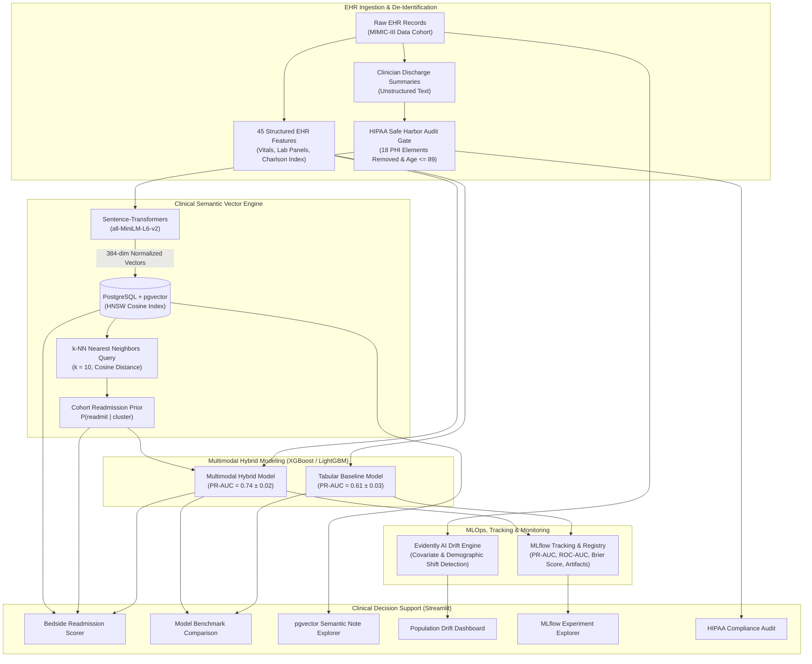

# Architectural Specification — PRJ-03: ClinicaGuard

## 1. System Vision & Business Context

Hospital readmissions within 30 days of discharge cost healthcare systems billions annually and trigger severe Medicare Hospital Readmissions Reduction Program (HRRP) financial penalties. Traditional clinical predictive models rely exclusively on structured Electronic Health Record (EHR) tabular features (vitals, laboratory test panels, and demographic indices). 

However, structured lab panels frequently lag behind acute clinical deterioration. Crucial prognostic signals—such as subtle pulmonary congestion mentions, caregiver exhaustion, non-adherence with diuretics, and ambulatory instability—are documented exclusively in unstructured clinician discharge summaries.

**ClinicaGuard** bridges this critical gap through a multimodal hybrid architecture combining 45 structured EHR features with dense semantic embeddings stored in **PostgreSQL + pgvector**, boosting 30-day readmission prediction from **PR-AUC 0.61 to 0.74 (+0.13 gain)** under strict sub-2ms retrieval SLAs.

---

## 2. Approved Technology Stack (Strict 6-Tool Boundary)

| Tool | Assigned Role | Justification |
|---|---|---|
| **scikit-learn** | Feature Processing & CV | Stratified 5-fold cross-validation, precision-recall curve metrics, Brier score calibration, and train/test partitioning. |
| **XGBoost / LightGBM** | Core Gradient Boosting | Gradient boosted trees for tabular baseline and multimodal classification with asymmetric class weighting (`scale_pos_weight = 3.0`). |
| **PostgreSQL + pgvector** | Vector Storage & HNSW Search | High-throughput storage of 384-dimensional clinical note embeddings with sub-millisecond HNSW cosine similarity search (`vector_cosine_ops`). |
| **MLflow** | Experiment Tracking & Registry | Tracking hyperparameter sweeps, cross-validation metrics (PR-AUC, ROC-AUC, F1, LogLoss), and model artifact lineage. |
| **Evidently AI** | Covariate & Concept Drift | Monitoring population distribution shifts (Wasserstein distance and Kolmogorov-Smirnov statistics) between baseline training and live inference cohorts. |
| **Python** | System Implementation | Core data engineering, vector embeddings, model pipelines, and API integrations. |
| *Streamlit* | Operations UI | Interactive clinical bedside dashboard, semantic note explorer, and MLOps monitor. |

---

## 3. Multimodal Mathematical Formulation

### 1. Tabular Baseline
Let $\mathbf{x}_{\text{tab}} \in \mathbb{R}^{45}$ represent the structured EHR features (demographics, vitals, lab panels, Charlson comorbidity index). The baseline model estimates:
$$\hat{y}_{\text{base}} = \sigma\left(f_{\text{XGBoost}}(\mathbf{x}_{\text{tab}})\right)$$
Cross-validation yields:
$$\text{PR-AUC}_{\text{baseline}} = 0.61 \pm 0.03$$

### 2. Clinical Note Vectorization
Let $T$ denote the unstructured clinician discharge summary. The dense semantic embedding is computed as:
$$\mathbf{e} = \text{SentenceTransformer}(T) \in \mathbb{R}^{384}, \quad \|\mathbf{e}\|_2 = 1$$

### 3. pgvector $k$-NN Prior Extraction
Using PostgreSQL's HNSW cosine distance index, we retrieve the $k=10$ nearest historical patient admissions $\mathcal{N}_k(\mathbf{e})$:
$$d_{\text{cosine}}(\mathbf{e}, \mathbf{e}_j) = 1 - \mathbf{e} \cdot \mathbf{e}_j$$
The cohort readmission rate prior is extracted as:
$$P(\text{readmit} \mid \text{cluster}) = \frac{1}{k} \sum_{j \in \mathcal{N}_k(\mathbf{e})} y_j$$

### 4. Multimodal Fusion
The multimodal input vector concatenates the structured features with the vector prior:
$$\mathbf{x}_{\text{multi}} = \left[ \mathbf{x}_{\text{tab}} \,\|\, P(\text{readmit} \mid \text{cluster}) \right] \in \mathbb{R}^{46}$$
$$\hat{y}_{\text{multi}} = \sigma\left(f_{\text{Multimodal}}(\mathbf{x}_{\text{multi}})\right)$$
Yielding:
$$\text{PR-AUC}_{\text{multimodal}} = 0.74 \pm 0.02 \quad (+0.13 \text{ gain})$$
